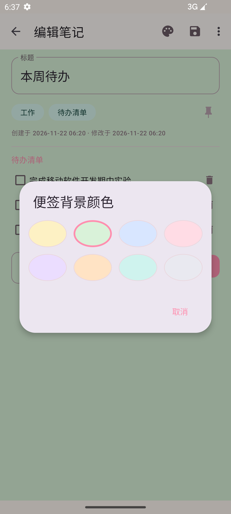
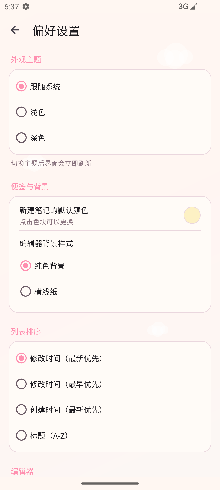
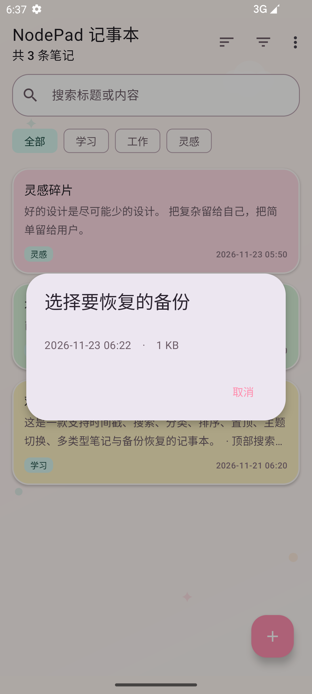

# NodePad 记事本

一个基于 Java + SQLite 的 Android 记事本应用。除笔记增删改查、时间戳、内容搜索等基本功能外，
还实现了分类管理、多类型笔记、待办清单、便签配色与主题、排序置顶、导出导入、备份恢复等功能。

## 界面预览

| 笔记列表 | 待办清单编辑 | 便签配色 |
| :---: | :---: | :---: |
|  |  |  |

| 偏好设置 | 备份与恢复 | 新建笔记类型 |
| :---: | :---: | :---: |
|  |  |  |

## 功能说明

### 基本功能

- **笔记列表显示时间戳**：列表卡片展示每条笔记的最后修改时间，按“yyyy-MM-dd HH:mm”格式显示；
  编辑器内同时展示创建时间与修改时间。
- **笔记内容搜索**：顶部搜索框输入关键字，即按“标题或正文”实时过滤，支持与分类筛选、类型筛选组合使用；
  无结果时展示空状态提示。

### 扩展功能

1. **笔记分类**
   支持为笔记设置分类，列表顶部以分类标签（Chip）筛选，编辑器内可直接新建分类，
   搜索与分类可叠加过滤。

2. **多类型笔记**
   新建时可选文字笔记、待办清单、图片笔记三种类型；图片笔记从相册选择图片并持久化读取权限，
   列表显示缩略图与类型徽标，工具栏可按类型筛选。

3. **待办清单**
   支持添加、勾选、删除待办项，列表卡片直接显示“已完成 1/3 · 第一项待办”的进度摘要。
   待办内容以 `[ ] 条目` / `[x] 条目` 纯文本存储，导出、备份后不丢失。

4. **便签美化与主题**
   采用糖果色系主题，主界面使用卡通渐变背景并点缀云朵、星星图案；提供 8 种便签背景色，
   列表卡片为圆角贴纸样式，卡片与编辑器背景同步着色，深色主题下自动调暗保证可读性；
   支持跟随系统、浅色、深色三种主题，以及纯色 / 横线纸两种编辑器背景样式。

5. **排序与置顶**
   支持修改时间升降序、创建时间、标题四种排序方式，重要笔记可置顶显示。

6. **导出与导入**
   使用系统文件选择器（SAF）将全部笔记导出为 JSON 文件，或从 JSON 文件导入笔记，
   无需申请存储权限。

7. **备份与恢复**
   一键备份到应用私有备份目录，自动保留最近 10 份；备份文件可通过系统分享保存到网盘、
   聊天工具等实现云备份；恢复时可选择合并或覆盖现有笔记。

8. **偏好设置**
   可配置主题模式、默认排序方式、编辑器正文字号、新建笔记默认便签颜色与编辑器背景样式，
   设置即时生效并持久保存。

## 技术实现

- **架构与语言**：Java + 原生 Android SDK，`AppCompatActivity` + Material 3 组件。
- **数据存储**：`SQLiteOpenHelper` 管理笔记表，数据库版本 2 通过 `ALTER TABLE` 增量升级，
  兼容旧版本数据不丢失。
- **搜索**：SQL `WHERE title LIKE ? OR content LIKE ?` 实现标题与正文模糊搜索，
  并与分类、类型条件动态拼接。
- **待办**：`TodoUtils` 负责待办文本的序列化与解析，清单项以 Markdown 风格复选框文本落库。
- **主题与配色**：`Prefs` 保存偏好，`AppCompatDelegate` 切换夜间模式；`NoteColors` 统一管理色板，
  `LinedPaperDrawable` 自定义 Drawable 绘制横线纸背景，`CuteBackgroundDrawable` 绘制卡通渐变背景
  与云朵、星星装饰，深浅色主题各有一套配色。
- **文件读写**：导出/导入使用 Storage Access Framework；备份通过 `FileProvider`
  生成可分享的 `content://` URI，不暴露真实文件路径。
- **UI**：`RecyclerView` + 自定义 `NoteAdapter`，`MaterialCardView` 便签卡片，
  `ChipGroup` 分类筛选，`MaterialAlertDialogBuilder` 完成排序、颜色、备份等交互。

## 项目结构

```text
app/src/main/
├── java/com/example/notepad/
│   ├── MainActivity.java           # 列表、搜索、筛选、排序、导出导入、备份恢复
│   ├── NoteEditorActivity.java     # 文字 / 待办 / 图片笔记编辑
│   ├── SettingsActivity.java       # 偏好设置
│   ├── data/
│   │   ├── Note.java               # 笔记数据模型
│   │   └── NoteDbHelper.java       # 建表、升级、查询
│   ├── ui/
│   │   ├── NoteAdapter.java        # 笔记列表适配器
│   │   ├── ColorPickerDialog.java  # 便签颜色选择
│   │   ├── CuteBackgroundDrawable.java # 卡通渐变背景
│   │   └── LinedPaperDrawable.java # 横线纸背景
│   └── util/
│       ├── Prefs.java              # 偏好设置读写
│       ├── TodoUtils.java          # 待办文本解析
│       ├── NoteColors.java         # 便签色板与深色适配
│       ├── NoteJsonUtils.java      # 笔记 JSON 序列化
│       └── BackupManager.java      # 本地备份管理
└── res/
    ├── layout/                     # 主界面、编辑器、列表项等布局
    ├── drawable/                   # 背景、图标等资源
    └── values/                     # 主题、颜色、字符串
```

## 运行方式

1. 使用 Android Studio 打开项目根目录，等待 Gradle Sync 完成。
2. Gradle JDK 选择 **JDK 17**（Gradle 8.11.1 不支持更高版本）。
3. 选择模拟器或真机，运行 `app` 模块。

命令行构建（Windows）：

```bash
gradlew.bat assembleDebug
```

APK 输出路径：`app/build/outputs/apk/debug/app-debug.apk`

环境要求：Android Studio、JDK 17、Android SDK 35，最低支持 Android 7.0（API 24）。


## 作者

- 姓名 / 学号：李金涵121052024004
- 课程：移动软件开发
