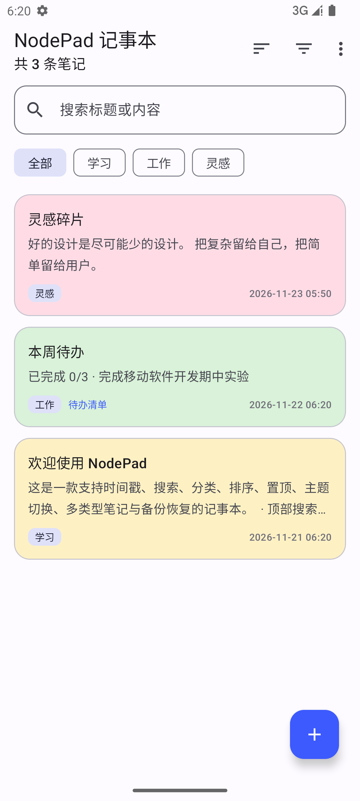
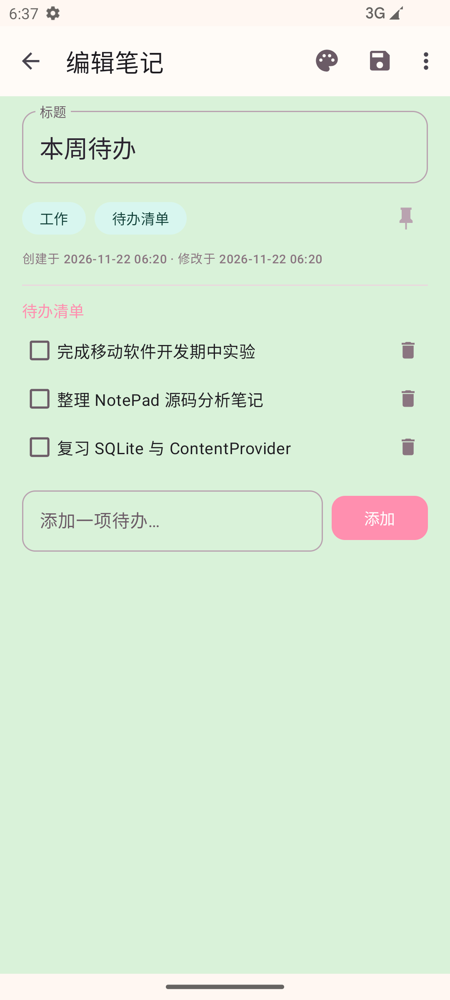
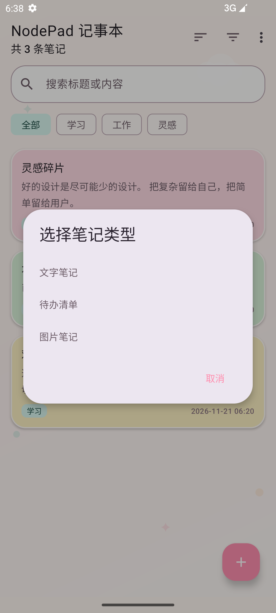
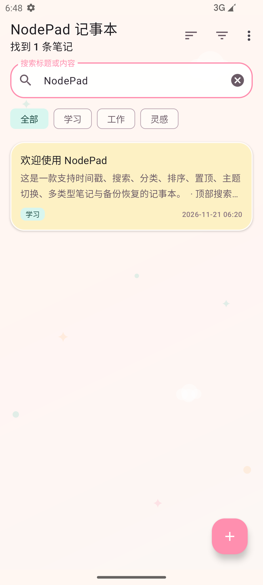
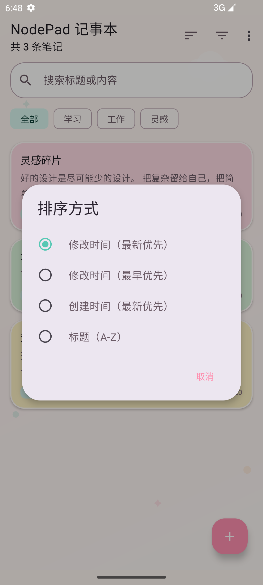
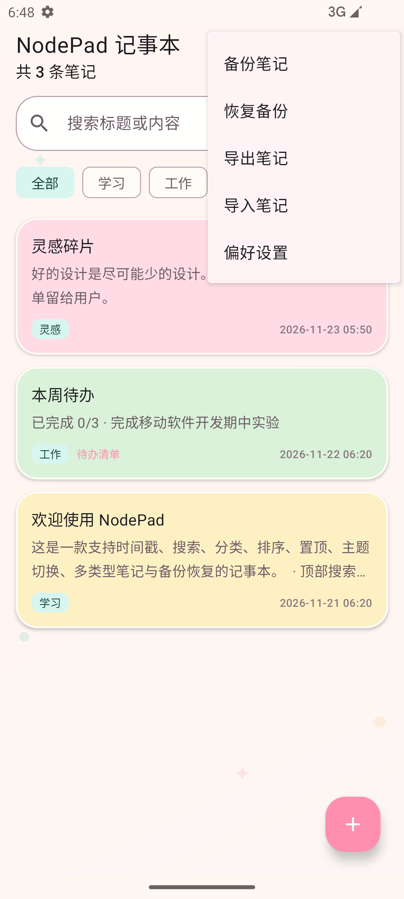

# NodePad 记事本

一个基于 Java + SQLite 的 Android 记事本应用。除笔记增删改查、时间戳、内容搜索等基本功能外，
还实现了分类管理、多类型笔记、待办清单、便签配色与主题、排序置顶、导出导入、备份恢复等功能。

## 界面预览

| 笔记列表 | 待办清单编辑 | 便签配色 |
| :---: | :---: | :---: |
|  |  |  |

| 偏好设置 | 备份与恢复 | 新建笔记类型 |
| :---: | :---: | :---: |
|  |  |  |

## 功能说明

### 基本功能

#### 1. 笔记列表显示时间戳

**做什么**：在笔记列表的每个条目下方显示该笔记的最后修改时间，进入编辑器后同时展示创建时间与修改时间。

**怎么做**：`Note` 模型保存 `createdAt` 与 `modifiedAt` 两个时间戳，新增或保存笔记时由 `NoteDbHelper`
写入当前时间；列表由 `NoteAdapter` 绑定 `TimeUtils.formatDateTime()` 格式化后的修改时间，
编辑器通过 `tvMeta` 展示创建与修改时间。

**完成截图**


#### 2. 笔记内容搜索

**做什么**：在顶部搜索框输入关键字，实时筛选出标题或正文包含该关键字的笔记，并可与分类、类型筛选组合使用。

**怎么做**：搜索框通过 `TextWatcher` 监听输入变化并触发重新查询；`NoteDbHelper.query()` 使用
`WHERE title LIKE ? OR content LIKE ?` 匹配标题和正文，再按需拼接分类与类型条件；
结果为空时展示空状态提示，并同步更新工具栏的笔记数量。

**完成截图**



### 扩展功能

#### 1. 笔记分类

**做什么**：为笔记设置分类，在列表顶部按分类筛选，编辑器内可直接新建分类。

**怎么做**：笔记表增加 `category` 字段；`NoteDbHelper.categories()` 通过 `SELECT DISTINCT category`
取出全部分类生成筛选标签；`ChipGroup` 单选切换后把分类作为查询条件传入 `query()`；
编辑器中的分类对话框列出已有分类，并支持输入新分类名称。

**完成截图**


#### 2. 多类型笔记

**做什么**：新建笔记时可选文字、待办、图片三种类型；图片笔记可从相册选择图片并在列表中显示缩略图。

**怎么做**：笔记表增加 `type` 与 `imageUri` 字段，新建时通过类型对话框选择；图片通过
`ActivityResultContracts.OpenDocument` 选择，并调用 `takePersistableUriPermission` 持久化读取权限；
`NoteAdapter` 根据类型显示类型徽标、待办进度或图片缩略图；工具栏提供按类型筛选的入口。

**完成截图**


#### 3. 待办清单

**做什么**：在待办笔记中添加、勾选、删除清单项，列表卡片直接显示完成进度与第一项内容。

**怎么做**：待办内容以 `[ ] 条目` / `[x] 条目` 的纯文本格式存入正文，`TodoUtils` 负责解析与统计；
编辑器用清单行展示复选框，勾选后回写文本；`NoteAdapter` 通过 `TodoUtils` 计算“已完成 1/3”并截取摘要，
因此导出、备份后待办状态不会丢失。

**完成截图**


#### 4. 便签美化与主题

**做什么**：提供糖果色主题、卡通渐变背景和 8 种便签背景色，支持浅色 / 深色 / 跟随系统切换，
以及纯色、横线纸两种编辑器背景。

**怎么做**：每条笔记保存颜色索引，`NoteColors` 统一维护色板并对深色模式下的卡片颜色做调暗处理；
主界面与设置页使用自定义 `CuteBackgroundDrawable` 绘制渐变和云朵、星星装饰；
编辑器使用 `LinedPaperDrawable` 绘制横线纸背景；主题切换通过 `AppCompatDelegate` 实现，
圆角贴纸卡片由 `MaterialCardView` 的圆角、描边和阴影组合而成。

**完成截图**


#### 5. 排序与置顶

**做什么**：支持修改时间升降序、创建时间、标题四种排序方式，重要笔记可置顶显示。

**怎么做**：排序方式保存在 `Prefs` 中，`NoteDbHelper.query()` 根据排序索引拼接
`ORDER BY pinned DESC, ...` 语句；置顶字段由编辑器中的图钉按钮切换并写入数据库，
列表查询时置顶笔记始终排在最前。

**完成截图**



#### 6. 导出与导入

**做什么**：把全部笔记导出为 JSON 文件，或从 JSON 文件导入笔记，便于迁移和留存。

**怎么做**：使用 Storage Access Framework 的 `CreateDocument` 与 `OpenDocument` 选择文件，
无需申请存储权限；`NoteJsonUtils` 负责把笔记列表序列化为 JSON、解析 JSON 并还原字段，
导入时逐条插入数据库，旧版本缺少的字段使用默认值兼容。

**完成截图**



#### 7. 备份与恢复

**做什么**：一键备份全部笔记到本地，保留最近 10 份；备份文件可分享到网盘或聊天工具实现云备份，
需要时可选择备份恢复。

**怎么做**：`BackupManager` 将笔记序列化后写入应用私有备份目录，并按时间清理旧备份；
通过 `FileProvider` 生成 `content://` URI 交给系统分享，避免暴露真实路径；
恢复对话框列出可用备份，支持“合并”或“覆盖”两种恢复方式。

**完成截图**


#### 8. 偏好设置

**做什么**：集中配置主题模式、默认排序方式、编辑器正文字号、新建笔记默认便签颜色和编辑器背景样式。

**怎么做**：所有选项通过 `Prefs` 写入 `SharedPreferences`；主题修改后调用 `AppCompatDelegate`
立即生效，字号与默认颜色在编辑器打开时读取，默认排序在列表查询时读取，设置项均持久保存。

**完成截图**


## 技术实现

- **架构与语言**：Java + 原生 Android SDK，`AppCompatActivity` + Material 3 组件。
- **数据存储**：`SQLiteOpenHelper` 管理笔记表，数据库版本 2 通过 `ALTER TABLE` 增量升级，
  兼容旧版本数据不丢失。
- **文件读写**：导出/导入使用 Storage Access Framework；备份通过 `FileProvider`
  生成可分享的 `content://` URI，不暴露真实文件路径。
- **UI**：`RecyclerView` + 自定义 `NoteAdapter`，`MaterialCardView` 便签卡片，
  `ChipGroup` 分类筛选，`MaterialAlertDialogBuilder` 完成排序、颜色、备份等交互。

## 项目结构

```text
app/src/main/
├── java/com/example/notepad/
│   ├── MainActivity.java           # 列表、搜索、筛选、排序、导出导入、备份恢复
│   ├── NoteEditorActivity.java     # 文字 / 待办 / 图片笔记编辑
│   ├── SettingsActivity.java       # 偏好设置
│   ├── data/
│   │   ├── Note.java               # 笔记数据模型
│   │   └── NoteDbHelper.java       # 建表、升级、查询
│   ├── ui/
│   │   ├── NoteAdapter.java        # 笔记列表适配器
│   │   ├── ColorPickerDialog.java  # 便签颜色选择
│   │   ├── CuteBackgroundDrawable.java # 卡通渐变背景
│   │   └── LinedPaperDrawable.java # 横线纸背景
│   └── util/
│       ├── Prefs.java              # 偏好设置读写
│       ├── TodoUtils.java          # 待办文本解析
│       ├── NoteColors.java         # 便签色板与深色适配
│       ├── NoteJsonUtils.java      # 笔记 JSON 序列化
│       └── BackupManager.java      # 本地备份管理
└── res/
    ├── layout/                     # 主界面、编辑器、列表项等布局
    ├── drawable/                   # 背景、图标等资源
    └── values/                     # 主题、颜色、字符串
```

## 运行方式

1. 使用 Android Studio 打开项目根目录，等待 Gradle Sync 完成。
2. Gradle JDK 选择 **JDK 17**（Gradle 8.11.1 不支持更高版本）。
3. 选择模拟器或真机，运行 `app` 模块。

命令行构建（Windows）：

```bash
gradlew.bat assembleDebug
```

APK 输出路径：`app/build/outputs/apk/debug/app-debug.apk`

环境要求：Android Studio、JDK 17、Android SDK 35，最低支持 Android 7.0（API 24）。

## 作者

- 姓名 / 学号：李金涵121052024004
- 课程：移动软件开发
